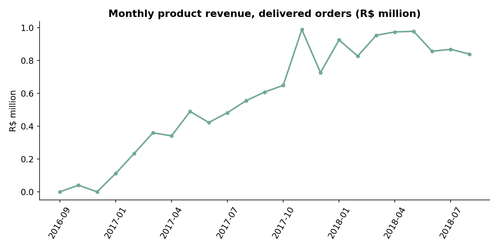

# Brazilian E-Commerce Analytics (Olist)

End-to-end business analytics project on 99,441 real marketplace orders:
advanced SQL, Python EDA and statistics, RFM segmentation, cohort retention,
and a Power BI star-schema dashboard.

## The business question

A Brazilian marketplace wants to know what drives revenue, repeat purchases,
delivery satisfaction and freight cost - and what to fix first.

## Headline findings

- **R$ 13.22 M** product revenue on 96,478 delivered orders (Sep 2016 - Oct 2018),
  peaking at **R$ 987,765** in Nov 2017.
- **Late delivery kills satisfaction:** 8.0% of orders arrive late; they average a
  **2.57** review score vs **4.29** on time, and take 31.4 days vs 10.9.
- **Customers rarely return:** 3.0% ever place a second order; month-1 cohort
  retention averages 4.7%.
- **Champions matter:** the top RFM segment (6.4% of customers) drives **14.3%** of
  lifetime revenue.
- **Credit cards dominate:** 78.3% of payment value, averaging 3.51 installments.

Full write-up with recommendations and limitations: [docs/findings_and_recommendations.md](docs/findings_and_recommendations.md)

## Repository layout

    sql/01_schema_and_load.sql   MySQL 8 schema + LOAD DATA for the 9 raw tables
    sql/02_core_analysis.sql     CTEs, window functions, cohort retention, RFM, freight
    notebooks/olist_analysis.py  full reproducible pipeline (validation -> metrics -> charts -> star schema)
    visuals/                     charts generated by the pipeline
    data-exports/                star schema CSVs for Power BI + analysis exports
    powerbi/dax_measures.md      model relationships, DAX measures, dashboard layout
    docs/                        findings, recommendations, limitations

## How to run

1. Download the data (see [data/README.md](data/README.md)) into `data/`.
2. `pip install -r requirements.txt`
3. `python notebooks/olist_analysis.py` - prints every metric and rebuilds all
   charts and exports. Validation checks run first and stop the pipeline on failure.
4. SQL: load `sql/01_schema_and_load.sql` in MySQL 8, then run
   `sql/02_core_analysis.sql` query by query.
5. Power BI: load the six CSVs from `data-exports/` and follow
   `powerbi/dax_measures.md`.

## Data source and license

Dataset: **Brazilian E-Commerce Public Dataset by Olist** - real orders from Olist,
a Brazilian marketplace, published on
[Kaggle](https://www.kaggle.com/datasets/olistbr/brazilian-ecommerce) and mirrored in
[Olist's own repository](https://github.com/olist/work-at-olist-data).
License: **CC BY-NC-SA 4.0** - credit Olist, non-commercial use, share alike.
Row and column counts verified against the raw files on 17 Oct 2026.

The same query logic in `sql/02_core_analysis.sql` was validated against SQLite and
pandas on the identical files; MySQL 8 is the target dialect.
